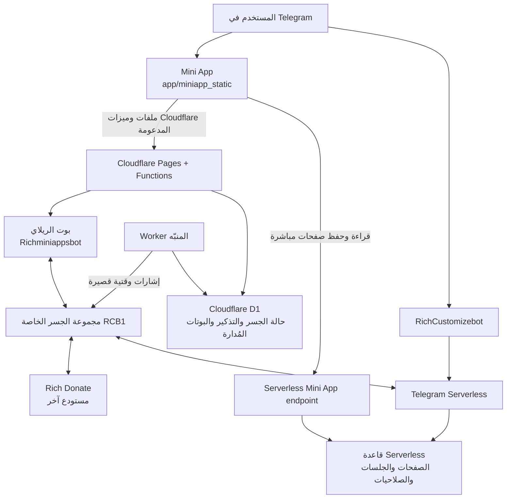

# خريطة مشروع Rich Customize

> شرح مبسّط لبنية المستودع كما هي على فرع `serverless-cleanup`، راجعه
> المستودع بتاريخ 2026-11-19.
> هذه خريطة للكود والملفات؛ وجود ملف هنا لا يثبت أن نسخته منشورة أو تعمل في الإنتاج.

## ١. الفكرة بأبسط شكل

تخيّل المشروع مثل مدرسة:

- **Telegram Serverless** هو الإدارة ودفتر السجلات: يشغّل البوت ويحفظ الصفحات.
- **Mini App** هو الصف الذي يستخدمه الشخص لصنع رسالة غنيّة.
- **Cloudflare** هو البوابة وساعي البريد: يقدّم الواجهة، ويتحقق من الطلبات، ويوصل رسائل الجسر.
- **Cloudflare D1** دفتر صغير لحالة الجسر والمواعيد وبيانات البوتات المُدارة؛ ليس دفتر الصفحات.
- **Worker** عامل Cron منفصل يعالج مواعيد النشر والتذكيرات وإشارات المزامنة؛
  ولا يخزن محتوى المنشورات.
- **الاختبارات** تمثيل تجريبي قبل فتح المدرسة، لكنها لا تثبت وحدها أن الإنتاج يعمل.

## ٢. رسم يبيّن من يتصل بمن



**المهم:** مو كل طلب يمرّ من Cloudflare. عمليات صفحات Mini App على استضافة
Serverless تتصل بواجهة Serverless مباشرة. بعض الخدمات الأخرى والجسر القديم
والرفع ما زالت تستخدم Cloudflare.

## ٣. شجرة المجلدات الرئيسية

```text
project-root/                      ← هذا هو مستودع Rich Customize
├── .github/workflows/             ← فحوص GitHub الآلية
├── .vscode/                       ← إعدادات محرر VS Code
├── app/miniapp_static/            ← ملفات واجهة Mini App الأصلية
├── cloudflare/d1/                 ← مخطط D1 وترحيلاته
├── docs/                          ← مدخل وثائق ومواد تاريخية
├── functions/                     ← مسارات Cloudflare Pages Functions
├── md_files/                      ← الوثائق الحالية وسجل التغيير
├── scripts/                       ← فحوص وبناء ملفات مولّدة
├── tests/serverless/              ← اختبارات JavaScript النشطة
├── tgcloud/                       ← كود البوت على Telegram Serverless
├── workers/schedule-reminders/    ← عامل Cron منفصل للتذكيرات
├── RichCustomizebot/              ← مجلد فرعي فيه manifests متتبعة
├── AGENTS.md                      ← قواعد العمل على المشروع
├── .gitattributes                 ← إعدادات Git للملفات
├── .gitignore                     ← الملفات المحلية التي لا تُرفع
├── README.md                      ← مقدمة ونظرة معمارية
├── package.json                   ← أوامر Node والاختبارات
├── package-lock.json              ← تثبيت إصدارات أدوات Node
└── tgcloud.jsonc                  ← إعداد ملفات Mini App في tgcloud
```

المجلدان `.git/` و`node_modules/` بيانات Git واعتماديات مثبتة، وليسا كود
التطبيق. كذلك `.tgcloud/` حالة محلية لأداة Telegram، و
`.tgcloud-miniapp-static/` نسخة بناء مولّدة؛ كلاهما مستثنى من Git حسب
`.gitignore`. لا تنسخ أو تنشر أسراراً من ملفات البيئة أو الحالة المحلية.

## ٤. شرح كل جزء

### `tgcloud/` — عقل البوت وبياناته

هذا هو كود `@RichCustomizebot` الذي يعمل في بيئة Telegram Serverless
(JavaScript داخل V8 مع واجهات `api` و`db` من المنصة).

| المسار | معناه ببساطة |
| --- | --- |
| [`tgcloud/schema.js`](../tgcloud/schema.js) | تعريف جداول قاعدة بيانات البوت. |
| [`tgcloud/handlers/`](../tgcloud/handlers/) | أبواب استقبال تحديثات Telegram، مثل رسالة أو ضغطة زر أو منشور قناة. |
| [`tgcloud/endpoints/`](../tgcloud/endpoints/) | أبواب API التي يستدعيها Mini App المستضاف على Serverless. |
| [`tgcloud/lib/`](../tgcloud/lib/) | وظائف العمل الفعلية: المحرر والصفحات والنشر والجسر والاشتراكات وغيرها. |
| [`tgcloud/lib/lang/`](../tgcloud/lib/lang/) | ملفات نصوص اللغات؛ تجمع بعض اللغات المتقاربة في ملفات مشتركة. |

الأبواب الموجودة في `handlers/`:

- `message.js`: نقطة توزيع الرسائل والأوامر.
- `callback_query.js`: الأزرار التي يضغطها المستخدم.
- `channel_post.js` و`edited_channel_post.js`: منشورات القنوات وتعديلها.
- `inline_query.js`: استعلامات Inline التي تدعمها الوظائف الحالية.
- `my_chat_member.js`: تغيّر عضوية البوت أو صلاحياته في مجموعة/قناة.
- `pre_checkout_query.js`: استعلام ما قبل إتمام دفع Telegram.
- `guest_message.js`: تحديثات Guest Mode المنفصلة.

يوجد endpoint واحد معلن في `tgcloud/endpoints/`: `miniapp.js` يوجه طلبات
Mini App ويتحقق من هوية Telegram قبل السماح بعمليات الحساب والصفحات.

من وظائف `lib/`: المحرر وإدارة الصفحات وتسليمها، النشر والجدولة، واجهات
Mini App والجسر، الاشتراكات والحقوق، البوتات المُدارة، اللغة وأدوات التشغيل.
تظهر هذه الوظائف في أسماء مثل `editor-*`, `page-*`, `publish*`,
`miniapp-*`, `subscription-*` و`managed-bot-*`؛ الأسماء الدقيقة تتغير مع
التطوير، لذا لا تعتمد هذه الأمثلة كقائمة كاملة.

تتغير قائمة الوحدات مع التطوير؛ استخدم الملفات الموجودة فعلياً وابحث عن
المستوردين والاختبارات قبل تعديل أي وحدة. ملفات `lang/` تجمع عدداً من
اللغات في ملفات مشتركة، لذلك عدد الملفات ليس عدد اللغات المدعومة.

تحتوي هذه النسخة حالياً على **98 وحدة قابلة للنشر**: `schema.js` و8 معالجات
وendpoint واحد و88 ملف JavaScript متداخلاً في `lib/` (بما فيها ملفات اللغة).
هذا العدد قريب من سقف Telegram Serverless البالغ 100؛ أعد العد قبل إضافة
أي وحدة، ولا تعتبر العدد ثابتاً بعد هذا التاريخ.

### `app/miniapp_static/` — واجهة المتصفح

هذه ملفات HTML وCSS وJavaScript التي يراها المستخدم داخل Mini App. أهم نقطة
دخول هي `editor.html`، والسلوك الأساسي في `app.js`.

- `miniapp_serverless_api.js`: الاتصال المباشر بواجهات Serverless.
- `live_preview.js` وملفات `editor_*` و`*_editor.js`: المحرر والمعاينة
  وأدوات بناء الرسائل.
- ملفات `.css`: شكل الشاشة، المكونات، التمرير والتخطيط.
- `miniapp_i18n*.js`: اللغة ونصوص الواجهة.
- `managed-bots.*`: شاشات إدارة البوتات المدعومة.
- `plan_catalog.generated.js`: كتالوج مولّد من سياسة الباقات؛ لا تعدّله
  يدوياً، بل استخدم سكربت التوليد.
- `tutorial-assets/`: صور وأصول الشرح.

التغييرات الأصلية تكون هنا. سكربت البناء ينسخ الواجهة إلى
`.tgcloud-miniapp-static/` ويحوّل مسارات الأصول كي يستضيفها Telegram
Serverless؛ النسخة المخفية ليست المصدر الذي تعدّله.

### `functions/` — واجهات Cloudflare

Cloudflare Pages يحوّل الملفات هنا إلى مسارات HTTP. `_middleware.js` يمر
على الطلبات المشتركة، و`_lib/` فيه الشيفرة التي يعاد استخدامها.

المجموعات الأساسية:

- `miniapp/api/`: التحقق من الحساب، الصفحات والوجهات، رفع الوسائط،
  الإيموجي، الأداء، الأخطاء، والجسر.
- `miniapp/api/bridge/`: Webhook رسائل الريلاي واسترجاع حالة الطلب.
- `miniapp/api/pages/`: مسارات الصفحات في واجهة Cloudflare.
- `miniapp/api/custom-emoji/`: عرض واستيراد حزم الإيموجي.
- `miniapp/api/upload/` و`media/`: نقل وسائط Mini App إلى Telegram.
- `miniapp/api/rich-buttons/`: تجهيز منتقي المستخدمين الأصلي.
- `internal/`: إعداد الجسر وفحوصه ومسارات داخلية محمية.
- `managed-bots/`: مسار إدارة بوتات محدد.
- `_lib/`: خدمات مشتركة مثل `b2b-bridge.js`, `telegram-auth.js`,
  `http.js`, `pages.js`, `custom-emoji-packs.js` و`broadcast-control.js`.

هذه الواجهات لا تجعل D1 قاعدة صفحات بديلة؛ Serverless هو صاحب الصفحة
والتحقق النهائي من صلاحيات التعديل. كما أن `_lib/` يحتوي وحدات مشتركة
للجسر والمصادقة والصفحات والحصص والوسائط والمهام والبوتات المُدارة، منها:
`custom-emoji-packs.js`, `golden-gift-access.js`,
`managed-bot-jobs.js`, `managed-bot-licenses.js`, `managed-bot-media.js`,
`managed-bot-pages.js`, `managed-bot-runtime.js`, `managed-bots.js`,
`managed-bot-service.js`, `page-mirror.js`, `quota-baseline.js` و
`telegram-api.js`.

شكل المسارات الأساسية:

```text
functions/
├── _middleware.js
├── _lib/                           ← خدمات مشتركة
│   ├── b2b-bridge.js               ← نقل الطلبات والردود وفحص هوية الجسر
│   ├── telegram-auth.js            ← التحقق من Telegram initData
│   ├── scheduling-reminders.js     ← بيانات مواعيد التذكير
│   ├── broadcast-control.js        ← تشغيل/إيقاف إشارات البث
│   └── ...                         ← صفحات، وسائط، حصص، بوتات مُدارة
├── internal/
│   ├── b2b-health.js
│   ├── managed-bots.js
│   ├── managed-licenses.js
│   └── setup-b2b-webhook.js
├── managed-bots/[botKey].js
└── miniapp/api/
    ├── client-error.js
    ├── destinations.js
    ├── managed-bots.js
    ├── me.js
    ├── performance.js
    ├── send.js
    ├── session.js
    ├── bridge/
    │   ├── webhook.js
    │   └── [request_id].js
    ├── custom-emoji/
    │   ├── pack.js
    │   ├── packs.js
    │   └── [emoji_id].js
    ├── media/[file_id].js
    ├── pages/
    │   ├── index.js
    │   └── [page_id].js
    ├── rich-buttons/user-picker.js
    └── upload/[kind].js
```

وبالتحديد، [`b2b-bridge.js`](../functions/_lib/b2b-bridge.js) هو مكتب
الاتصالات في Cloudflare: يجهّز أوامر RCB1، يتحقق من المجموعة وهوية البوت،
يربط كل طلب بمعرّفه، ثم يسجل الرد القادم. لا يعتبر نفسه مالك الصفحات أو
محتوى الرسائل.

### `cloudflare/d1/` — قاعدة صغيرة لـCloudflare

- `schema.sql`: المخطط الأساسي.
- `managed_bots.sql`: SQL منفصل لجداول البوتات المُدارة وتحديثاتها.
- `migrations/0001-managed-bots-runtime.sql`: جداول خدمة إدارة البوتات.
- `migrations/0002-schedule-reminders.sql`: بيانات تشغيل التذكيرات.
- `migrations/0003-broadcast-tick-control.sql`: مفتاح تشغيل/إيقاف إشارات البث.
- `cleanup-legacy.sql`: تنظيف قديم منفصل وخطِر؛ لا يُشغّل دون مراجعة وموافقة.

D1 تحفظ معرّفات الطلبات والهوية والحالة وأوقات التنفيذ، وكذلك سجلات إدارة
البوتات وفق مخططها المنفصل. مخطط إدارة البوتات يحتوي حقلاً مخصصاً لرمز مخزن مشفراً؛ لا تعرض
قيم قواعد البيانات أو الأسرار. D1 لا تحفظ محتوى الصفحات المجدولة أو جمهور
البث، وليست قاعدة الصفحات أو الفوترة. لا تخلط بين تعديل ملف SQL وبين تطبيقه
على قاعدة حية؛ هذان شيئان مختلفان.

### `workers/schedule-reminders/` — ساعة المنبّه

- `worker.js`: يستجيب لمواعيد Cron ويرسل إشارات RCB1 قصيرة.
- `wrangler.toml`: اسم Worker وإعداداته وجدول التشغيل وربط D1.

هذا Worker منفصل عن البوت الرئيسي: لا يحرر الرسائل ولا ينشر محتواها بنفسه.
Telegram Serverless يحتفظ بمحتوى المنشور والمستلمين وينفذ المهمة؛ Worker
يساعد على تذكير النظام بموعدها. إشارات البث ومزامنة Rich Donate وفحص
الاشتراكات لها أنواع منفصلة.

### `tests/serverless/` — ساحة التجربة

ملفات `*.test.mjs` تختبر سلوك JavaScript النشط. `harness.mjs` يوفر بيئة
تجريبية تحاكي بعض واجهات Telegram Serverless حتى يمكن تشغيل الاختبارات محلياً.
تجد اختبارات للمحرر والصفحات والجسر والنشر والاشتراكات والواجهة والأخطاء.

- `npm test`: تشغيل مجموعة الاختبارات النشطة.
- `npm run test:ci`: فحوص الخطة والملفات الثابتة، ثم مجموعة الاختبارات.
- `npm run check:miniapp`: فحص روابط أصول Mini App وبعض عقود العرض.

الاختبارات المحلية لا تثبت أن Telegram أو Cloudflare أو الدفع الحقيقي يعمل
في الإنتاج. اختبارات Python القديمة محفوظة كنصوص `.py.txt` داخل الأرشيف
وليست الاختبار الحالي.

### `scripts/` — أدوات مساعدة

- `build-miniapp-serverless.mjs`: تجهيز نسخة Mini App خاصة باستضافة
  Telegram Serverless.
- `check-miniapp-static.mjs`: التأكد من وجود ملفات الواجهة وفحص بعض عقودها.
- `generate-plan-catalog.mjs`: إنشاء كتالوج الواجهة من سياسة الباقات
  الموثوقة في Serverless.

### `md_files/` و`docs/` — كتب المشروع

- [`md_files/`](./) هو مكان الوثائق الحالية وسجل التغييرات.
- [`md_files/PROJECT-MAP.md`](./PROJECT-MAP.md) هو هذا الدليل المبسّط.
- [`md_files/docs/`](./docs/) فيه أدلة مثل Serverless وCloudflare والجدولة
  والاشتراكات والتوطين.
- [`md_files/log.md`](./log.md) هو سجل التغييرات النشط.
- [`md_files/sups.md`](./sups.md) مواصفة الاشتراكات؛ ظهور رقم فيها لا يعني
  أنه نُفّذ أو نُشر.
- [`md_files/ROADMAP.md`](./ROADMAP.md) و`soon.md` خطط، وليستا كوداً شغالاً.
- `md_files/docs/archive/`: وثائق قديمة محفوظة.
- `docs/README.md` فهرس الوثائق، و`docs/tgcloud-sdk.md` مرجع واجهة SDK.
- `docs/archive/`: مواد تاريخية، منها اختبارات Python كنصوص ومخطط
  اشتراك قديم غير نشط.

إذا تعارضت خطة قديمة مع الكود أو الوثائق الحالية، لا تعتبر الأرشيف تعليمات
للتنفيذ.

### ملفات الجذر والإعدادات

| الملف/المجلد | وظيفته |
| --- | --- |
| `README.md` | مقدمة المشروع وروابط بدء القراءة. |
| `AGENTS.md` | قواعد وحدود التطوير والنشر والبيانات. |
| `package.json` و`package-lock.json` | أوامر Node وأداة `@tgcloud/cli` وإصداراتها. |
| `tgcloud.jsonc` | يحدد مجلد أصول Mini App الذي سيقرأه tgcloud. |
| `.github/workflows/` | فحوص آلية عند تغييرات مختارة. |
| `.vscode/` | إعدادات بيئة المحرر. |
| `.gitignore` | يستثني الاعتماديات والحالة المحلية والملفات السرية. |

يوجد أيضاً مجلد متتبّع اسمه `RichCustomizebot/` يحتوي `package.json` و
`package-lock.json` خاصين به. لا يشير ملف إعداد tgcloud أو سكربت البناء إليه
كمصدر تشغيل أساسي؛ سبب وجوده الدقيق غير محسوم في هذه الخريطة، لذلك لا تحذفه
ولا تعتمد عليه قبل فحص منفصل. يحتوي محلياً على `node_modules/` مستثنى من Git.

## ٥. ثلاث رحلات مهمة داخل المشروع

### صنع صفحة وحفظها

```text
المستخدم
  → Mini App: يحرر مسودة محلية
  → يضغط حفظ صراحةً
  → واجهة Serverless الموثقة بـ initData
  → فحص المالك والإصدار
  → tgcloud/schema.js: حفظ الصفحة
```

المسودة المحلية ليست نسخة محفوظة. ولا ينبغي أن يثق الخادم بخطة أو مالك
يرسلهما المتصفح.

### نشر أو جدولة منشور

```text
صفحة محفوظة أو رسالة محرر
  → tgcloud/lib/publish.js أو scheduled-publish.js
  → تحقق من الصلاحيات والمحتوى
  → Worker يذكّر عند الموعد
  → Serverless ينفذ الإرسال إلى Telegram
```

يحتفظ Serverless بلقطة المنشور والوجهات. D1 تحمل بيانات الموعد والحالة فقط.

### اختبار تغيير قبل النشر

```text
تعديل الملف
  → اختبار محدد أو npm test
  → مراجعة git diff
  → تحديث md_files/log.md
  → ثم خطة نشر مناسبة للمكوّن
```

نشر Serverless وترحيل قاعدة بياناته عمليتان منفصلتان. نشر Cloudflare Pages
لا يعني نشر Worker أو كود Telegram تلقائياً، والعكس صحيح.

## ٦. من أين أبدأ إذا أردت تعديل شيء؟

| أريد أن أغيّر… | ابدأ من… |
| --- | --- |
| أمر أو رسالة للبوت | `tgcloud/handlers/` ثم الوحدة المناسبة في `tgcloud/lib/`. |
| طريقة تخزين بيانات البوت | `tgcloud/schema.js` واختبار الوحدة؛ راجع الحاجة للترحيل. |
| شكل المحرر أو المعاينة | `app/miniapp_static/`. |
| اتصال Mini App المباشر بـServerless | `tgcloud/endpoints/miniapp.js` و`tgcloud/lib/miniapp-bridge.js` والعميل في الواجهة. |
| صفحة Cloudflare أو Webhook | المسار الموافق في `functions/` ثم `_lib/`. |
| تذكير مجدول أو إشارة Cron | `workers/schedule-reminders/worker.js` و`tgcloud/lib/scheduled-publish.js`. |
| حدود الاشتراك أو نصوصها | `tgcloud/lib/subscription-policy.js` و`md_files/sups.md` و`subscription-rollout.md`. |
| نص بلغة معينة | `tgcloud/lib/lang/` أو ملفات ترجمة Mini App. |
| فحص انكسر | الاختبار المقابل في `tests/serverless/`. |

## ٧. أشياء خارج التشغيل النشط

- Rich Donate مشروع منفصل: [ihhaiq/richDonate](https://github.com/ihhaiq/richDonate).
- `subscription-bot` موجود داخل الأرشيف فقط، وليس خدمة دفع نشطة هنا.
- Python وAiogram لا يشكلان runtime الحالي؛ الاختبارات القديمة محفوظة
  كمرجع نصي.
- `.tgcloud-miniapp-static/` ناتج بناء يمكن توليده من الواجهة الأصلية.
- `.tgcloud/`, `.env`, `node_modules/` وبيانات المستخدم ليست ملفات توثيق
  عامة؛ لا ترفعها أو تنسخ أسرارها.

للتفاصيل الدقيقة عن الحدود والنشر، أكمل القراءة من
[`docs/README.md`](../docs/README.md) ثم [دليل Serverless](./docs/serverless.md)
و[دليل Cloudflare](./docs/cloudflare-pages-miniapp.md).
